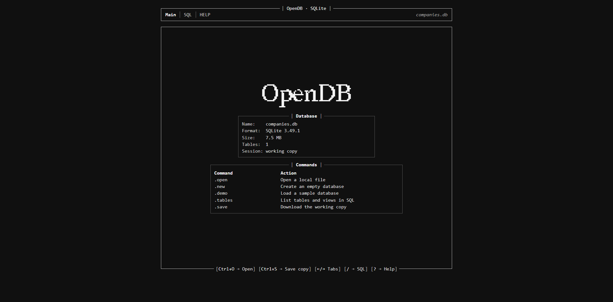
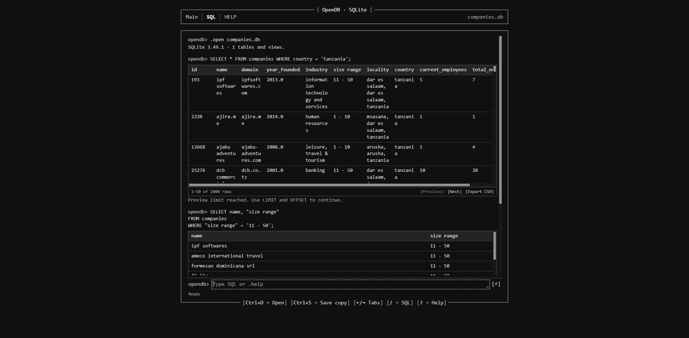

<div align='center'>


An offline SQLite console with a black-and-white terminal interface.




</div>

# Run locally
With Python 3 installed, open a terminal in the OpenDB folder and run:

```
py -m http.server 8000 --bind 127.0.0.1
```


Use python3 instead of py on Linux or macOS. 

```
Open http://127.0.0.1:8000.
```

# Quick start

- Use .open to load a file, .new to start an empty database, or .demo to try the sample.
- In SQL, type a statement and press Enter. After .demo, try SELECT * FROM customers;.
- Use .save to download the edited database or .export to download the latest result as CSV. Finish any open transaction before saving.
- Open HELP or type .help for the full command list.
SQL changes apply to a working copy. Download it with .save before closing.